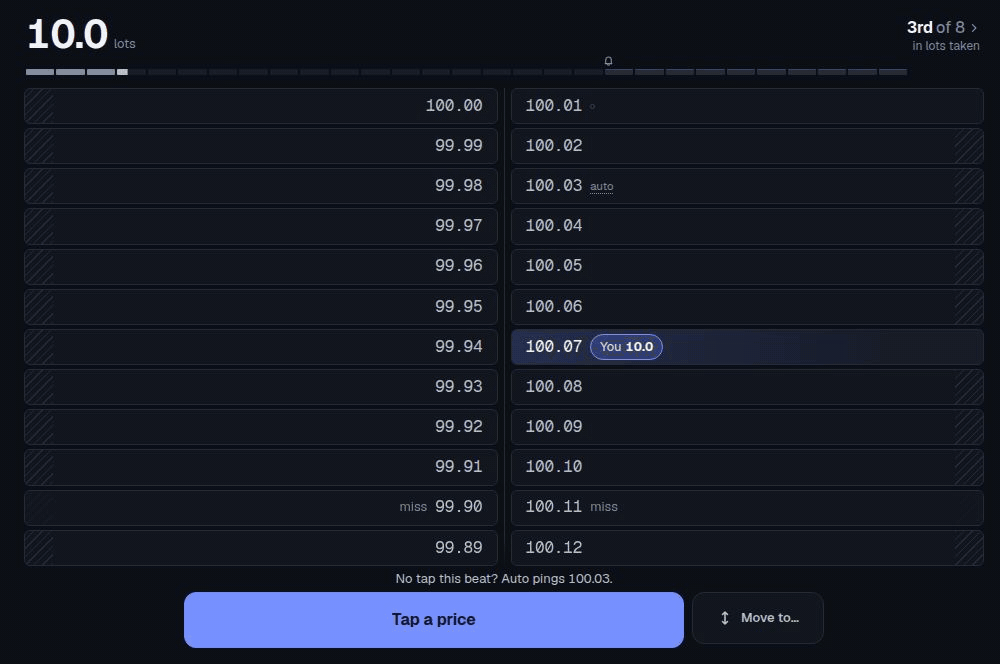
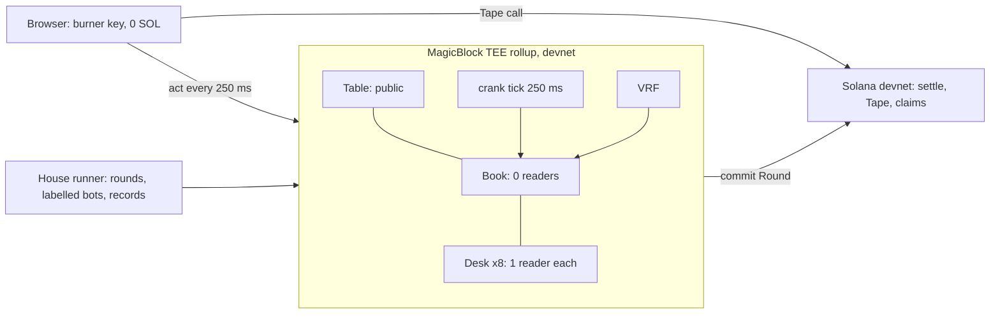

**PICKED OFF: a 50-second dark pool. Hide your order, ping for everyone else's, pick them off before the closing bell. Only MagicBlock's TEE knows where anyone is.**  
▶ **Play, no wallet: https://picked-off-smoky.vercel.app** · beat → private result **111 ms p95** (n = 74 beats, EU browser, 2026-11-24)  
<!-- 60-s video: <VIDEO LINK> -->

A MagicBlock Solana Blitz v10 entry, on Solana devnet and MagicBlock's devnet TEE rollup.




## How to play

- Open the link. Your browser makes a burner key, logs in to the rollup and takes a house bot's desk: no wallet, no popup, no SOL. You have **10 lots resting dark** on one of 24 price levels.
- Every **1.5-s beat** you do one thing: **PING** a price (click a rung), or **RE-QUOTE** (move your order). Do nothing and your algo pings an untested price for you.
- A ping where rivals rest **picks off** a slice of each: 0.5 lot, then 1.0, then 1.5 if you keep finding the same order before it moves. Only you see **FILL** or **miss**. Only the victim sees **PICKED OFF**, never by whom.
- The **closing bell** rings after a secret beat between 20 and 29 (VRF). Lights on: the whole book replays in public, every desk is paid resting + picked, the browser re-runs the round and checks its hash. Zero rake.

Keys: Space pings your last FILL, R re-quotes to a random untested level.

## Why this needs a private rollup

Every beat each desk asks a private question ("is anyone resting at 100.04?") about positions that keep moving: about 200 private answers per round (8 desks × ~25 beats), each inside its beat.

- **Commit-reveal cannot answer a query.** A commitment hides a level but cannot say whether it equals 100.04 unless its owner reveals it, every beat, honestly. A desk that has just been found would stop answering.
- **A public chain cannot hold the book.** Any readable account with levels hands every ping to a script.
- **A plain server could run it**, but its operator could peek. Here the house key that runs the rounds gets `null` for the Book like everyone else.

| Take one out | What it does here | Without it |
|---|---|---|
| Private Ephemeral Rollup (TEE + permissions) | the Book has **0 readers**; each Desk has **1 reader**, its seated key (`EphemeralPermission`, [`setup_permissions.rs`](programs/ping/src/instructions/setup_permissions.rs)) | levels public, so no game; or a trusted server |
| Ephemeral Rollup + scheduled crank | beats resolved by a 250-ms `ScheduleCrankCpi` crank against slot deadlines, cancelled with `CancelCrankCpi` after the bell; gasless `act` every 250 ms per desk | Solana fees for 32 tx/s per pool; no constant-rate traffic, so timing would leak |
| VRF (rollup queue) | bell beat, in-beat order, algo pings, default level, last tie-break ([`open_round.rs`](programs/ping/src/instructions/open_round.rs), [`vrf_callback.rs`](programs/ping/src/instructions/vrf_callback.rs)) | a host-chosen bell or order could favour a desk |
| Delegate + commit to Solana | pools are `delegate`d once to the pinned TEE validator ([`delegate.rs`](programs/ping/src/instructions/delegate.rs)); each recorded round's result is `commit_and_undelegate`d alone ([`commit_round.rs`](programs/ping/src/instructions/commit_round.rs)) and `settle_round` pays the Tape from it | settlement by hand; the Tape not tied to the result |
| Burner keys on a gasless rollup | a 0-SOL key signs an `act` every 250 ms ([`burner.ts`](app/src/chain/burner.ts), [`sender.worker.ts`](app/src/chain/sender.worker.ts)) | a wallet popup every beat; no instant join |

## Who can read what

| | During HIDE / LIVE | After the bell |
|---|---|---|
| **You** (your Desk) | your level, resting, picked, your FILL / miss / PICKED OFF per beat, your algo's next ping | everything |
| **Other players** | nothing about you; only the public Table | everything |
| **Spectators** | seats, BOT badges, clock, each desk's **picked** tally, prints "GHOST-2 filled 0.5 · price withheld", Tape odds | the whole Book replayed |
| **Nobody, the house included** (the Book) | all levels, resting lots, streaks, ping history, pending actions, the bell beat, the seed | public, replayable to the commit hash |

## What an outsider can and cannot see

Measured on devnet, 2026-11-24, by [`scripts/leak-probe.ts`](scripts/leak-probe.ts) (two clean runs of 3 rounds; as another player, an outsider, no token) and [`tests/devnet/a5-check.ts`](tests/devnet/a5-check.ts) (18 recorded rounds, 23,117 acts).

| Side channel | Defence | Measured on devnet |
|---|---|---|
| Read the Book or another Desk | 0-member / 1-member permissions | `null` from `getAccountInfo`, `getProgramAccounts` and `accountSubscribe` (0 events) for every non-member |
| Read a ping transaction | the TEE redacts private txs | `getTransaction` of an `act` or crank tick: slot only, 0 keys, 0 data, 0 logs, **for the sender too** |
| List someone's transactions | not listed while private | 0 of a desk's acts in 15 signature lists (program, Table, Book, Desk, burner) |
| Log streams | `logsSubscribe` | 0 private txs delivered before the reveal on program, Table, Book or `"all"` streams (9 rounds, 63 subscriptions) |
| Timing of clicks | every desk sends one fixed-size `act` every 250 ms; ping, re-quote and no-op look the same | identical act counts on all 8 desks; 0 failed acts in 23,117 |
| Compute units | constant-work `act` and `tick` (fixed loops, masks read through `read_volatile`, [`mask.rs`](crates/ping-core/src/mask.rs), [`engine.rs`](crates/ping-core/src/engine.rs)) | every `act` **4,767 CU** (n = 12,321, every kind, phase, wrong key, stale seq); every resolving tick **75,881 CU** (n = 447); every no-op tick **27,658 CU** (n = 2,615); max − min = 0; 0 program log lines (no `msg!` in the program) |
| Squatting the crank | task id = hash(table, round, current slot hash), computed on chain ([`utils.rs`](programs/ping/src/utils.rs)) | 5 squatted ids per round; beats ran on time |
| Last round's history | re-seal, then reset every private field, before the next HIDE | after the re-seal the revealed round's txs are shells again; levels are drawn fresh |

In the game, **🔒 Try to peek** runs five of these reads live from your browser ([`peek.ts`](app/src/chain/peek.ts)).

## The money

- **Zero rake.** Chips are conserved: every lot a desk loses, another desk picked off. Free house pools pay chips, no value.
- **The Tape**: parimutuel on "Top Desk at the bell" for rounds with a human seated; one 0.01-devnet-SOL call per burner, closes after live beat 10, settled on Solana from the committed round, refunded if nobody called the winner. Callers get devnet SOL from a capped drip ([`drip.ts`](app/api/drip.ts)).
- An **open odds** board (simulated, labelled so). Staked tables are not built.

## Skill, simulated

From the game's balance model: 4,000 simulated rounds per cell, payout in stakes, everyone reacting like a typical human unless named. Model numbers, not live play.

| Seat-0 strategy | vs house bots | vs 7 attentive humans |
|---|---|---|
| Re-ping fills, re-quote when picked off | 1.34 | 1.21 |
| Same, present on half the beats | 0.97 | 0.85 |
| Best strategy using only public information | 0.75 | 0.75 |
| Never click (algo only) | 0.44 | 0.42 |
| Script reading results at machine speed | 1.40 | 1.27 |

At a 1.5-s beat a machine-speed reader gains only 0.03-0.07 stakes over a typical human in this model.

## Nearest past entries

| Entry | What it was | How PICKED OFF differs |
|---|---|---|
| Cayed (Blitz v0) | 1v1 Battleship, ships hidden in an Ephemeral Rollup | 8 desks at once, each hides *and* hunts, money moves on every fill, simultaneous 1.5-s beats, no wallet |
| Private Battleship (Blitz v3) | 1v1 turn-based Battleship in a TEE | not turn-based or 1v1; orders move, and every private answer moves money |
| magic-ship | Private Ephemeral Rollup Battleship demo | the same, plus a settled money loop (the Tape) |
| HoldOut (Blitz v8) | 10 players, 60 s, fold or hold against a public SOL price | the same one-minute tension, but the information is private per player, not a public price |
| Herd (Blitz v8) | one question, 30 s, match the crowd; answers sealed in a private rollup | sealed choices too, but 20-29 times a round, live, about *where*, not *how many* |
| Blackout (Blitz v9) | fog-of-war battle royale in a private rollup | the same "only the TEE sees positions" idea on an order book, one action per 1.5 s so reflexes don't decide |

## Architecture



- Program: [`programs/ping`](programs/ping/src) (Anchor, `ephemeral_rollups_sdk`: `#[ephemeral]`, `#[delegate]`, `commit_and_undelegate`, `ScheduleCrankCpi`, `EphemeralPermission`, `#[vrf]`). Beat resolution: [`crates/ping-core`](crates/ping-core/src), the same engine ported to TypeScript for the replay check ([`app/src/core`](app/src/core)).
- House runner and labelled bots: [`house/`](house/src). Bots are ordinary desks that read only their own Desk and act at human speed ([`bots.ts`](house/src/bots.ts)).

## Verify it yourself

- Base layer: the [program on Solana Explorer](https://explorer.solana.com/address/5eP2A36T97mwaGHf6XoHZU6VoKh1NGxA2QwvtJhAJ6ms?cluster=devnet) shows per recorded round a delegation, the validator's commit, `settle_round` and `close_round`. Play itself never touches the base layer.
- Rollup: [house pool 1's Table on the TEE](https://explorer.solana.com/address/C9F937UM7d254jBMp1kNh1MnpSRcw6TcP2GkBUiXxq27?cluster=custom&customUrl=https%3A%2F%2Fdevnet-tee.magicblock.app) (explorer custom cluster `https://devnet-tee.magicblock.app`). Between a bell and the next re-seal its ticks and acts are readable in full; during play they are not.
- After each bell the game prints "replay ✓ … matches commit": the browser re-runs the revealed log from the seed ([`replay.ts`](app/src/core/replay.ts)).

Measured on devnet, 2026-11-24 (program version 1, TEE validator in Singapore):

| What | Result |
|---|---|
| Beat timing | 430 live beats over 18 rounds: 418 resolved on the deadline slot, 12 one slot late, none twice |
| VRF | request → callback 2 slots in 17 of 18 rounds (6 on the first after deploy); no fallback seed |
| Delegation | usable on the TEE 217-582 ms after base confirmation (20 pool accounts) |
| Round record | 816-byte Round committed alone 18/18; commit → base p50 1.5 s (1.2-6.3 s) |
| Failures | 0 of 23,117 acts, 0 of 373 house and bettor txs |
| Walletless join | link → own Desk on screen: p50 4.3 s, max 5.8 s (27 fresh browsers, EU) |

## Build and test

```sh
make setup doctor build   # Anchor 1.0.2, Agave 4.1.2, ephemeral-rollups-sdk 0.17.3
make test                 # Rust + TypeScript tests, golden vectors
make test-svm             # program in MagicSVM: rounds, compute, security
make leak-probe-devnet    # side-channel probes on devnet
make browser-check URL=https://picked-off-smoky.vercel.app
```

## Review

Before the deploy, a reviewer who did not write the program attacked it. The checks are tests in [`security_static.rs`](tests-magicsvm-rs/tests/security_static.rs), [`security_base.rs`](tests-magicsvm-rs/tests/security_base.rs), [`security_rollup.rs`](tests-magicsvm-rs/tests/security_rollup.rs), [`cu.rs`](tests-magicsvm-rs/tests/cu.rs) and [`lifecycle.rs`](tests-magicsvm-rs/tests/lifecycle.rs) (all passing). They cover: permissions only by the program's rules; only the house commits, only a finished Round; delegation only to the pinned TEE validator; seed-checked accounts, look-alikes refused; `tick` harmless at any time; one action per desk per beat; one VRF result per round from the pinned identity; a uniform bell; `act` and `tick` never fail; claims pay each owner once; constant compute, no logs; an unpredictable crank id; nothing carried into the next round.

Found and fixed:
- Any burner could brick a desk for every later holder by acting with the largest sequence number. Now the counter restarts when the desk changes hands.
- Aborting a recorded round without its record left the record stuck on the rollup. Now abort requires it.
- The devnet build accepted local-test admin, validator and VRF keys. Now they exist only in a `local` build.
- Crank iterations were unbounded. Now capped at 10,000.

Left open, by design or for lack of time:
- Free seats can be squatted (see Limits).
- A Tape not settled within 30 minutes of its close turns void (refunds). The house settles right after each commit, and clients send settle and claim together.
- Replacing a stalled crank does not cancel the old task; its ticks are no-ops and the iteration cap bounds them.

## Limits

- **Devnet only.** Money is devnet SOL; free pools pay chips.
- **The TEE is trusted** for privacy: the hardware and MagicBlock's validator see everything.
- **The house key is trusted for liveness**: it opens, reveals and commits rounds, seats bots, reseats idle seats, and can abort a round (Tape refunded). It cannot read the Book or a player's Desk before the bell, unseal early, commit anything but a Round, or pay a call to anyone but its bettor.
- **Everything is public after the bell**, by design: the whole round's transactions, keys and data, until the next re-seal hides them again. Nothing in it helps the next round.
- **Seated players know more than spectators** on the Tape, and one person can call from a second burner. In the model, calling with your own exact total is right 44.4% of the time vs 42.5% for the public favourite.
- **No sybil resistance in free pools.** Anyone can take free seats, and several burners can sit at one pool; each takeover hands over that desk's results so far, like colluding players. In the model, two desks sharing everything gain about 0.03 stakes each.
- **Bots were tuned in the model, not on humans.** All skill numbers above are simulated.
- **Latency is from one region** (EU). The game shows each visitor their own measured number.
- **Log streams replay a round once it is public.** A few acts sent in the last half second before a bell land just after it, still private, and a log subscriber receives them when that round is revealed about a second later (seen as 9 deliveries next to another pool's live round). They carry constant CU and no logs, and the round they belong to is over.

MIT licence.
